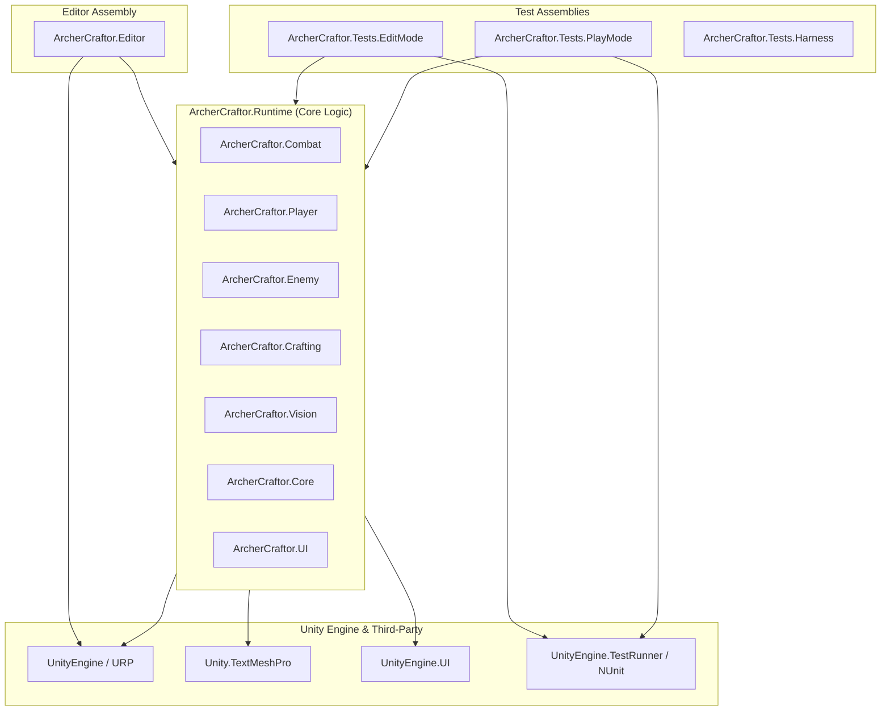
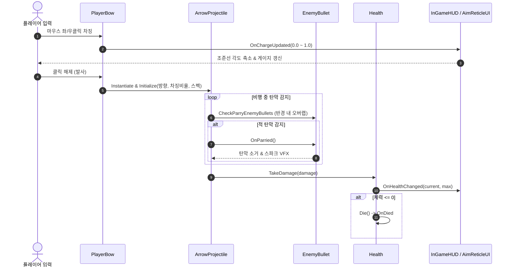

# ArcherCraftor - 아키텍처 및 시스템 설계 (ARCHITECTURE.md)

> 본 문서는 ArcherCraftor 프로젝트의 소프트웨어 아키텍처, 어셈블리 계층, 데이터 및 이벤트 흐름을 규정합니다.

---

## 1. 어셈블리 계층 구조 (Assembly Architecture)

---

## 2. 모듈별 역할 및 책임 (Module Responsibilities)

| 모듈 (Namespace) | 주요 역할 | 주요 클래스 예시 | 의존 관계 |
| :--- | :--- | :--- | :--- |
| **`ArcherCraftor.Combat`** | 탄막 상쇄, 투사체 비행, 충돌 판정, 체력 및 대미지 파이프라인 | `ArrowProjectile`, `EnemyBullet`, `Health`, `IDamageable` | 독립 도메인 |
| **`ArcherCraftor.Player`** | 쿼터뷰 8방향 이동, 360도 마우스 조준 회전, 활 차징 및 듀얼 발사 | `PlayerController`, `PlayerBow` | `Combat` 참조 |
| **`ArcherCraftor.Enemy`** | 카이팅 거리 유지 이동, 탄막 에미터, 상태 머신 | `EnemyAI`, `EnemyBulletEmitter` | `Combat` 참조 |
| **`ArcherCraftor.Crafting`** | 월드 자원 채집 루팅, 즉석 화살 조합 레시피, 퀴버 인벤토리 | `FieldCraftingManager`, `ArrowRecipe` | `Combat`, `Player` 연동 |
| **`ArcherCraftor.Vision`** | 《Duckov》 스타일 쿼터뷰 FOV 절차적 원뿔 시야각 메시 및 그림자 마스킹 | `FieldOfView` | 독립 렌더링 |
| **`ArcherCraftor.Core`** | Aim Peek 쿼터뷰 카메라 추적, 게임 매니저, 상쇄 통계 | `TopDownCameraFollow`, `GameManager` | 전역 이벤트 브리지 |
| **`ArcherCraftor.UI`** | 크로스헤어, 차징 인디케이터, HUD 체력바 | `AimReticleUI`, `InGameHUD` | 이벤트 구독 |
| **`ArcherCraftor.Editor`** | 샌드박스 프로토타입 씬 자동 빌더 도구 | `ArcherCraftorSceneBuilder` | 런타임 전체 |

---

## 3. 핵심 데이터 & 이벤트 흐름 (Event Flow)

---

## 4. 품질 및 테스트 전략 (Testing Strategy)
- **EditMode 테스트 (`ArcherCraftor.Tests.EditMode`)**:
  - 수학 수식(조준 각도/사거리 Lerp, 탄속/대미지 공식)의 100% 무결성을 보장합니다.
  - 체력 감산, 최소/최대 클램핑, 사망 트리거 이벤트의 단독 검증을 담당합니다.
  - 즉석 제작 레시피 및 재료 차감 로직을 엔진 씬 로딩 없이 0.1초 내로 검증합니다.
- **PlayMode 테스트 (`ArcherCraftor.Tests.PlayMode`)**:
  - 물리 컴포넌트(`SphereCollider`, `Rigidbody`)와 프레임 단위 이동(`Time.deltaTime`) 통합 검증.
- **자동화 하네스 스크립트 (`scripts/harness/verify.ps1`)**:
  - `.meta` 파일 누락 감지, `.asmdef` 문법 검사, `Update()` 내 검색 호출 안티패턴을 사전 차단합니다.

