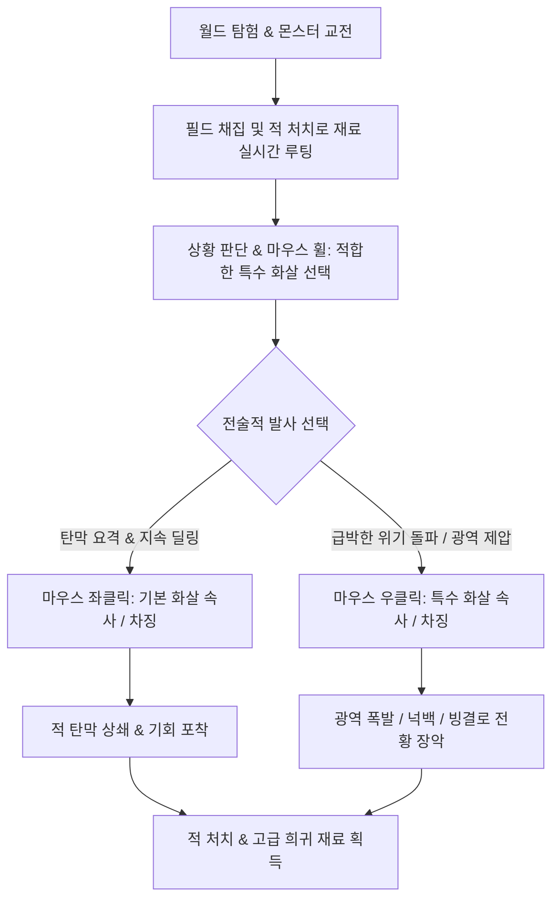

# ArcherCraft (아처크래프트) - 게임 기획 & 컨셉 문서 (GDD Draft)

> 📖 관련 기획 문서: [스토리 & 세계관 기획 (Story.md)](Story.md)

---

## 1. 핵심 컨셉 (Core Concept)

- **장르**: 2D 탑다운 쿼터뷰 궁술 슈팅 액션 (Top-Down Tactical Archery)
- **비주얼 톤**: 미니멀 로우폴리 + 5가지 기후 테마 (오염된 어둠 vs 치유되는 자연의 시각적 대비)
- **키워드**: `수호신 근위병 궁수`, `순수 궁술(Pure Archery)`, `탄막 상쇄(Counter-Shot)`, `자연 재료 즉석 화살 조합(Field Crafting)`
- **방향성**: 
  - 병든 오염물질과의 접촉을 피해, **오직 정화의 활과 화살, 거리 조절(거리별 사격술)만으로 모든 위기를 돌파하는 순수 궁수 액션**.
  - 근접해오는 적 역시 근접 타격기가 아닌, **특수 화살(넉백/속박/충격파) 또는 속사(퀵샷)와 대시**를 통해 카이팅 및 제어.

---

## 2. 조작 체계 (Controls Scheme)

| 입력 | 기능 | 설명 |
| :--- | :--- | :--- |
| **W, A, S, D** | 이동 | 8방향 기본 이동 |
| **Space Bar** | 대시 (회피) | 순간 무적 프레임 및 포지셔닝 재배치 |
| **마우스 이동** | 조준 | 360도 자유 조준 (크로스헤어 & 탄도 가이드) |
| **마우스 휠 (Scroll)** | **특수 화살 선택 (Arrow Select)** | 휠을 굴려 활시위에 걸 특수 화살 종류(충격/화염/서리 등) 실시간 순환 선택 |
| **좌클릭 (Tap)** | **기본 화살 속사 (Quick Shot)** | [무한 탄약] 즉시 발사. 날아오는 **적 탄막 요격/상쇄**에 최적화 |
| **좌클릭 (Hold)** | **기본 화살 차징샷 (Power Shot)** | [무한 탄약] 시위를 당겨 사거리, 탄속, 물리 관통 피해 극대화 |
| **우클릭 (Tap)** | **특수 화살 속사 (Special Quick)** | [소모 탄약] 선택된 특수 화살 즉발 발사 (근접 긴급 넉백, 소형 폭발 등) |
| **우클릭 (Hold)** | **특수 화살 차징샷 (Special Power)** | [소모 탄약] 특수 화살의 기믹(광역 폭발, 광역 빙결, 대형 낙뢰 등) 대폭 강화 |

---

## 3. 활 조준 시스템 (Aiming System)

> **핵심 규칙:**  
> **"시위를 당길수록(차징할수록) `조준 각도`는 좁아지고, `조준 사거리`는 길어집니다."**  
> 끝까지 차징하면 `조준 각도`가 0이 되어 완전한 일직선으로 곧게 날아갑니다.

### 3.1. 핵심 용어 정의
- **조준 시스템**: 활시위를 당기는 차징 시간에 따라 각도와 사거리가 실시간으로 변화하는 시스템
- **조준 각도**: 화살이 발사될 수 있는 부채꼴 모양의 조준 범위 각도
- **조준 사거리**: 화살이 도달할 수 있는 부채꼴의 최대 비행 거리

---

### 3.2. 차징 단계별 조준 상태

| 단계 | 조준 각도 | 조준 사거리 | 특징 및 전술적 활용 |
| :--- | :--- | :--- | :--- |
| **차징 전 (즉발/속사)** | **최대 조준 각도 (120°)** *(넓은 부채꼴 범위)* | **최소 조준 사거리** *(짧은 거리)* | - 넓은 부채꼴 범위로 대충 쏴도 전방 적/탄막 포착 - **초근접 적 대응 및 날아오는 적 탄막 요격/상쇄**에 최적화 |
| **차징 중 (조준 집중)** | 120° → 0°로 점진적 축소 | 최소 → 최대로 점진적 증가 | - 시위를 당기는 동안 부채꼴 가이드라인이 점차 좁고 길어짐 |
| **차징 완료 (완충/정밀)** | **최소 조준 각도 (0°)** *(각도가 없는 완전한 직선)* | **최대 조준 사거리** *(가장 먼 거리)* | - 원하는 목표를 100% 명중시키는 정밀 저격 - **단단한 정예 몬스터 일격 관통 및 장거리 저격** |

---

## 4. 화살 시스템: 무한 기본 화살 & 즉석 제작 (Field Crafting)

> 게임명 **ArcherCraft(아처크래프트)**의 핵심 정체성: **"궁술(Archer) + 현장 즉석 제작(Craft)"**  
> 작업대나 긴 제작 대기시간 없이, 월드를 누비며 채집한 재료로 **전투 현장에서 바로바로 특수 화살을 조합/제작**하여 발사합니다.

### 4.1. 탄약 메커니즘
- **기본 화살 (Standard Arrow)**:
  - **수량 무제한 (Infinite)**
  - 탄막 상쇄, 지속 견제, 기본 원거리 공격의 든든한 뼈대.
- **특수 화살 (Crafted Special Arrows)**:
  - **수량 제한 (제작 소모형 탄약)**
  - 월드에서 실시간 채집/파밍한 재료를 조합하여 즉시 제작.
  - 전세를 뒤집는 강력한 기믹(군중 제어, 광역 폭발, 지형 관통, 속성 부여 등).

---

## 5. 월드 파밍 & 즉석 제작 (Quick Crafting) 시스템

### 5.1. 월드 재료 파밍 (Gathering)
플레이어는 필드를 이동하고 카이팅하며 근접 시 자석처럼 흡수(또는 상호작용)하여 재료를 수집합니다.

| 재료 분류 | 대표 아이템 예시 | 획득처 | 주요 역할 |
| :--- | :--- | :--- | :--- |
| **광물/결정** | 부싯돌, 흑요석 파편, 충격석 | 광맥 오브젝트, 바위 파괴 | 관통력 증가, 물리 충격/넉백 |
| **동물/식물** | 화염초 열매, 서리 버섯, 가시 덩굴 | 필드 채집 식물, 덤불 | 화염 장판, 빙결 감속, 출혈/속박 |
| **몬스터 전리품**| 골렘 파편, 도깨비불 기름, 독낭 | 적 처치 시 즉시 드롭 | 폭발, 전도 전류, 부식성 안개 |

### 5.2. 즉석 화살 조합 레시피 예시 (Arrow Recipes)

| 특수 화살명 | 필요 기본 재료 | 발사 효과 (속사 vs 차징) | 전술적 용도 |
| :--- | :--- | :--- | :--- |
| **충격 화살 (Impact)** | 기본 화살 + 충격석(부싯돌) | **[속사]** 근접 적 강한 넉백 **[차징]** 적을 날려보내 벽 충돌 시 광역 기절 | 초근접 돌진 몬스터 카운터 (근접 공격 대체) |
| **화염 폭발 화살 (Blast)** | 기본 화살 + 도깨비불 기름(화염초) | **[속사]** 소형 폭발로 탄막 다수 소거 **[차징]** 착탄 지점에 거대한 화염 폭발 + 장판 지속딜 | 밀집된 적 무리 및 대형 보스 화력 집중 |
| **서리 속박 화살 (Frost)** | 기본 화살 + 서리 버섯 파편 | **[속사]** 단일 대상 3초간 이동속도 70% 둔화 **[차징]** 주변 범위 적 전체를 순간 빙결(얼어붙음) | 도주로 확보 및 적 카이팅 거리 유지 |
| **번개 연쇄 화살 (Spark)** | 기본 화살 + 정전기 결정 | **[속사]** 탄막 적중 시 주변 적/탄막으로 방전 연쇄 소멸 **[차징]** 적중 대상에게 번개 낙뢰 소환 | 탄막이 빽빽한 위기 상황에서 화면 클리어 |
| **독성 안개 화살 (Toxic)** | 기본 화살 + 독낭 분말 | **[속사]** 관통 후 지나간 자리에 독 안개 생성 **[차징]** 착탄 시 방어력을 깎는 지속 독구름 폭발 | 단단한 엘리트 몬스터 방어력 약화 |

---

## 6. 마우스 휠 선택 & 좌/우클릭 발사 메커니즘 (Dual Quiver System)

### 6.1. 좌/우클릭 대칭 발사 구조
플레이어는 상황에 따라 번거로운 모드 변경 없이 마우스 버튼 하나로 기본 화살과 특수 화살을 직관적으로 사격합니다.

- **좌클릭 (Left Click) = 기본 화살 (무한 탄약)**
  - `탭 (Tap)`: 빠른 속사로 날아오는 적 탄막 요격 및 상쇄
  - `홀드 (Hold)`: 관통력과 기본 피해가 증가하는 물리 파워샷
- **우클릭 (Right Click) = 특수 화살 (소모 탄약)**
  - `탭 (Tap)`: 급박한 상황에서 특수 효과 즉발 투사 (돌진 적 긴급 넉백, 소형 폭발)
  - `홀드 (Hold)`: 특수 화살의 기믹 대폭 강화 (광역 폭발, 화면 단위 연쇄 전격, 광역 빙결)
- **마우스 휠 (Scroll Up / Down) = 특수 화살 종류 전환**
  - 마우스 휠을 위/아래로 굴려 현재 장전된 특수 화살(`충격` ↔ `화염` ↔ `서리` ↔ `번개`)을 즉시 순환 변경.
  - 화면 중앙 조준선(Reticle) 옆에 현재 선택된 특수 화살 아이콘 및 잔여 탄약 실시간 표시.

### 6.2. 현장 즉석 제작 (Quick Crafting) 연계 UX
- **방법 1. 탄약 소진 시 자동 제작 (Auto-Craft on Fire)**:
  - 잔여 특수 화살이 0발일 때 우클릭(발사) 시도 시, 재료가 충분하다면 즉시 1발을 조합하여 딜레이 없이 바로 발사.
- **방법 2. 퀵 제작 단축키 (Quick Craft Key)**:
  - `Q` 키 또는 `E` 키를 누르면 현재 휠로 선택된 특수 화살을 재료 한도 내에서 즉시 묶음 제작.
- **방법 3. 마우스 휠 클릭 (Middle Click)**:
  - 마우스 휠 버튼을 클릭하면 현재 선택된 특수 화살 1발 즉시 제작.

---

## 7. 핵심 게임플레이 루프 (Core Gameplay Loop)

---

## 8. 향후 구상 논의점
1. **재료 획득 방식**: 
   - 일일이 멈춰서 줍지 않고 뱀서(Vampire Survivors)나 덕코프처럼 근처에 가면 자석처럼 쏙 들어오는 자동 흡수가 적합할지?
2. **제작 실패/희귀 레시피**: 
   - 처음부터 모든 레시피를 알고 시작할지, 던전 깊숙한 곳이나 보스를 잡고 '새로운 화살 도안(레시피)'을 해금하는 방식이 좋을지?
3. **가방/인벤토리 제한**: 
   - 화살통 크기(예: 특수 화살은 슬롯당 최대 5~10발)를 두고 화살통 업그레이드 요소를 넣을지?
4. **엔드게임 반복 순찰 (Patrol Loop)**: 
   - 엔딩 후 5개 기후 지역의 오염 주기 순찰 및 고난도 심화 던전(Story.md 참조)을 통한 파밍 및 보스 대련 콘텐츠 연계.
